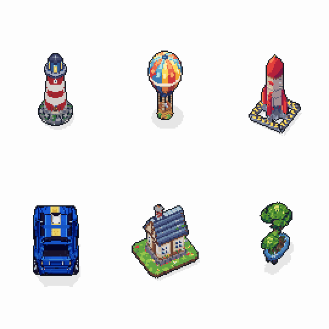
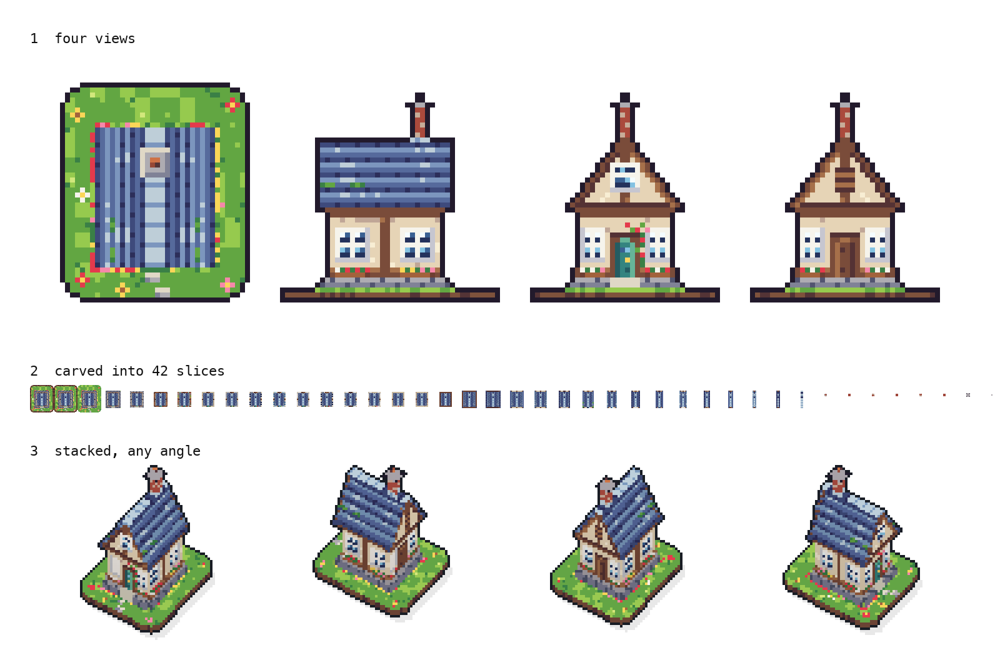

# sprite-stacking

An agent skill that turns four pixel art views into fake-3D sprites you can spin. By Daniel White.




## Install

```bash
npx skills add danielwh2/sprite-stacking
```

Installs to the current project. Add `-g` for every project, `-a claude-code` (or `codex`, `cursor`, ...) to pick an agent. Uses the [skills CLI](https://github.com/vercel-labs/skills), Node 22.20 or later.

Or copy `skills/sprite-stacking` into your agent's skills folder:

| Agent | Folder |
| --- | --- |
| Claude Code | `~/.claude/skills/` |
| Codex, Cursor, OpenCode, Gemini CLI, Pi | `~/.agents/skills/` |

## Use

Ask your agent:

- "Make a rotatable pixel art car."
- "Sprite stack this 4-view sheet and give me a turntable."
- "Add a fake 3D pixel art tree to my Godot game."

No image generator? The agent draws the views itself in a short Python script.

## How it works



1. **Views:** top, side, front and back, orthographic, one row.
2. **Carve:** a voxel survives only where all four views cover it.
3. **Slices:** the volume is cut into a strip of flat layers, ground first.
4. **Render:** each layer is rotated, squashed for pitch and lifted 1 px.

## Slicer CLI

```bash
python3 skills/sprite-stacking/scripts/views_to_slices.py views.png slices.png \
  --slices 36 --preview check.png --html viewer.html
```

- `--slices N`: layer count. 15-20 chunky, 32-48 detailed.
- `--order reading`: force TOP, SIDE, FRONT, BACK. Default matches views by proportion.
- `--side-nose right`: the side view faces right.
- `--colours N`: shared palette size, `0` keeps every colour.

## Viewer

`--html` writes a standalone page: turntable, slice scan, exploded view, drag to orbit, 16-direction PNG export. `skills/sprite-stacking/scripts/viewer.html` also opens on its own and takes a dropped slice strip.

## Requirements

Python 3 with Pillow and NumPy (`pip install pillow numpy`).

## Contributing

```bash
python3 tests/check.py
```

Prints `ok`.

## Prior art

Sprite stacking is a long-standing indie game technique, not invented here. This skill adds the four-view carving and the agent workflow.

## Licence

MIT
